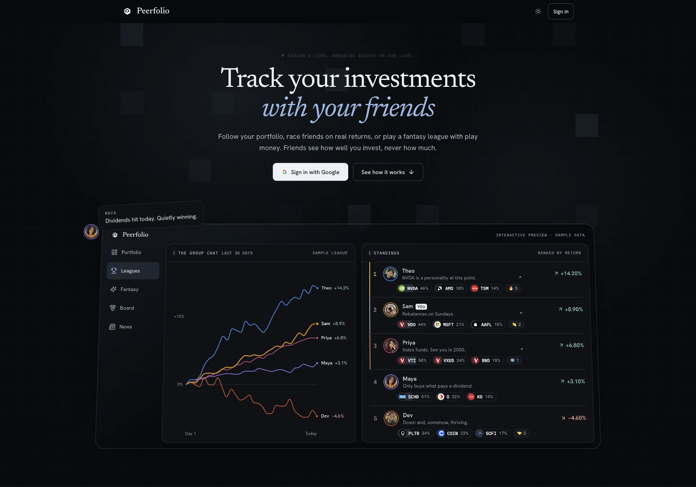
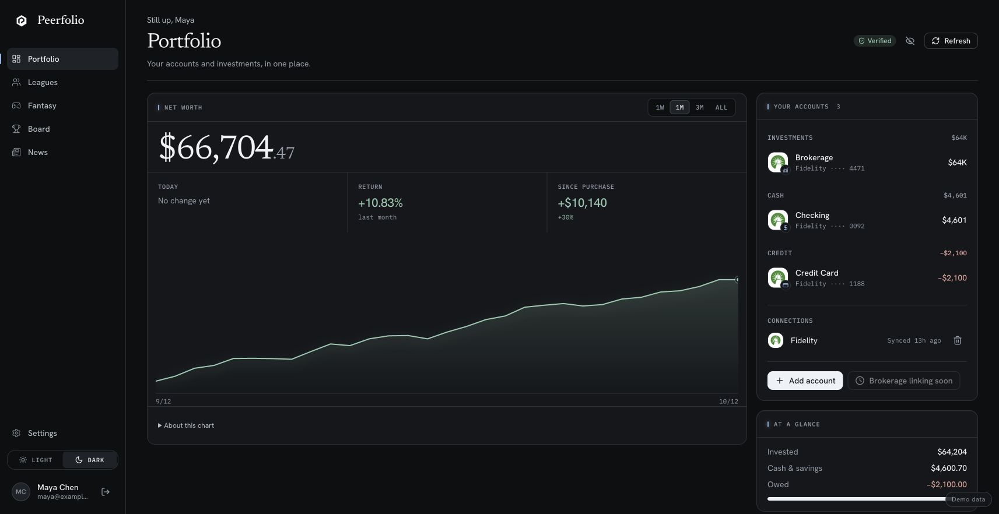
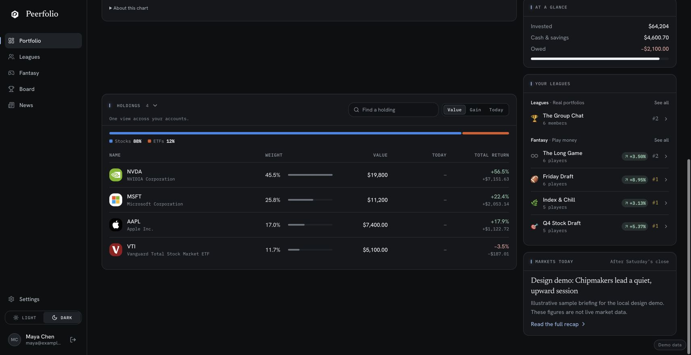
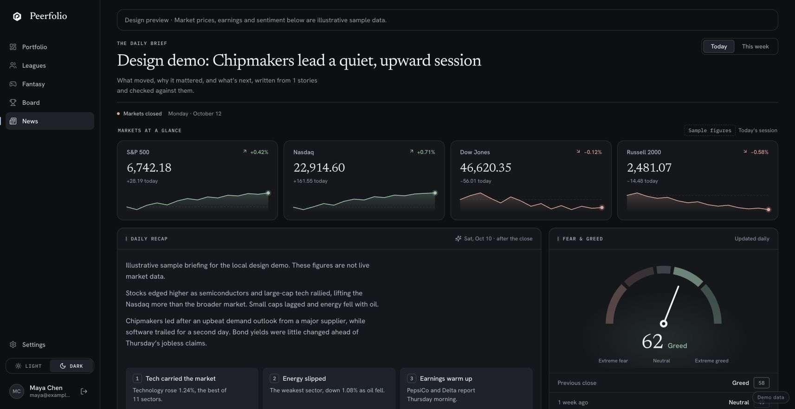
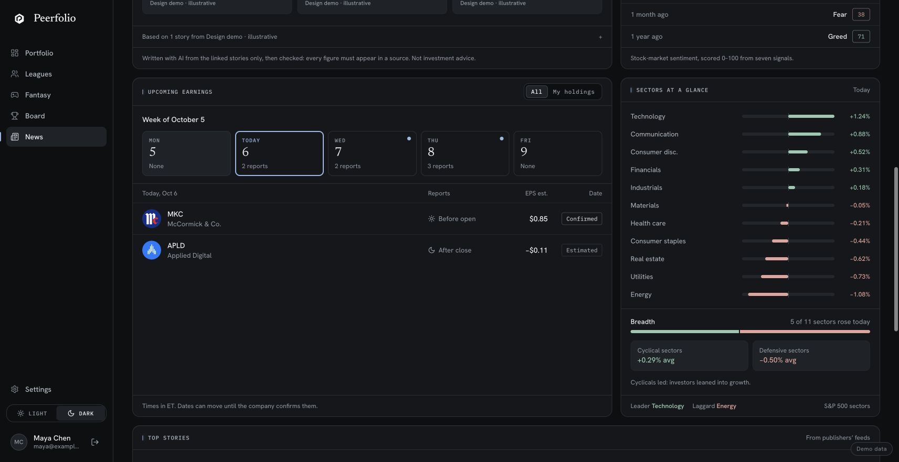
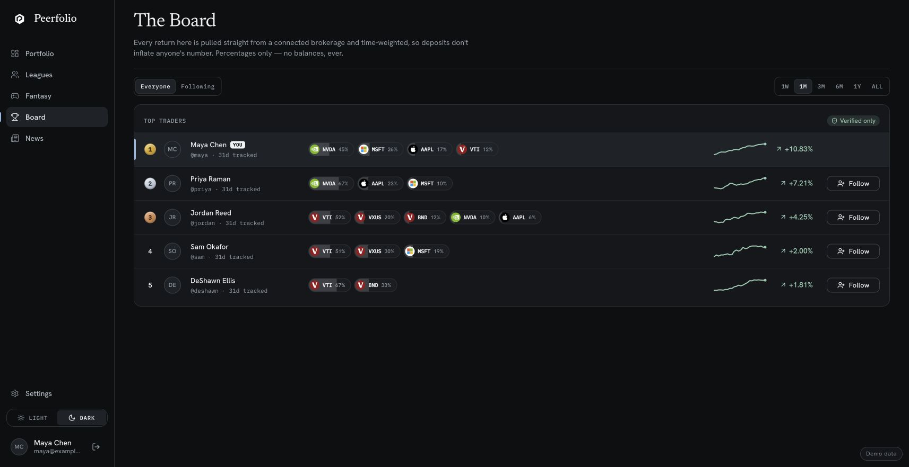
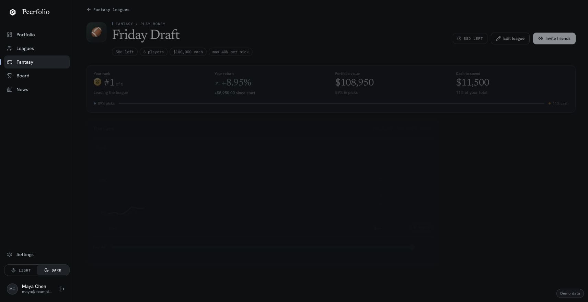
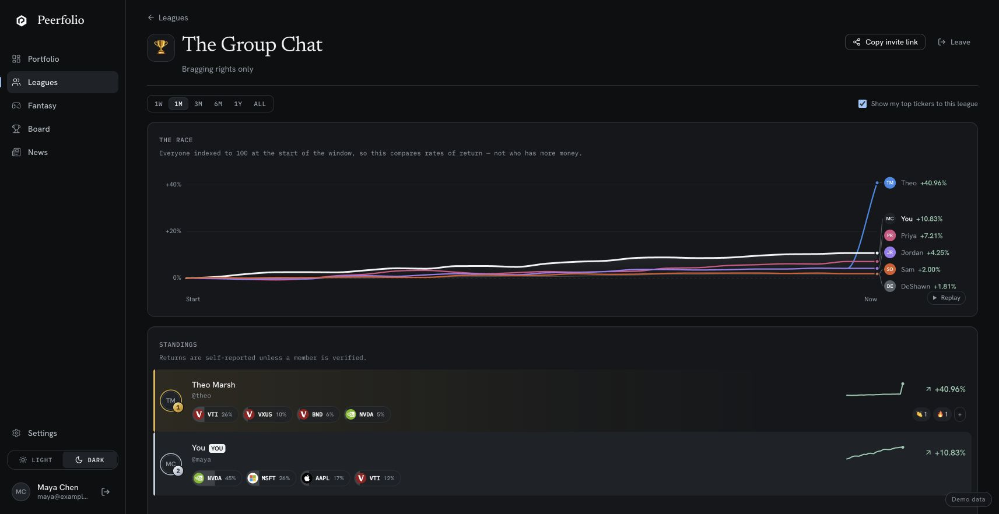

# Peerfolio

Social investing built around one rule: **percentages are public, dollars never
are.**

Blossom, AfterHour and Robinhood Social are public feeds with follower counts
and dollar amounts. Peerfolio is built on one engine with several surfaces:

- **Portfolio** — your own net worth, accounts and positions in one place, with
  a time-weighted return that ignores deposits and withdrawals. Only you see it.
  Accounts are added by hand or linked through Plaid (limited connections per
  account for now).
- **Leagues** — small groups of friends joined by invite link, ranked on return.
- **Fantasy** — play-money leagues where everyone starts with the same cash,
  picks stocks and races. Nothing here touches a real balance.
- **Sports (beta)** — play-money leagues on real games: moneyline, spread,
  total and player-prop picks, parlays, live in-game picks at live odds,
  leaderboards and invite links. Virtual cash only; this is not real-money
  betting or gambling.
- **The Board** — an opt-in public leaderboard of top investors, where every
  return is pulled from a connected brokerage rather than typed in.
- **News** — a daily and weekly market recap, index moves, Fear & Greed and the
  week's earnings, so there's something to read before the next move.
- **Ask Peerfolio** — a read-only AI assistant that answers questions about your
  portfolio, leagues and the market. It cannot trade and gives no advice.

Returns are **time-weighted**, so deposits don't count as performance. Whoever
adds the most cash doesn't win; that's what makes a ranking worth reading.

## Screenshots

Captured from the current UI using an isolated local demo database. Names, accounts, balances, positions and news figures are invented; no personal portfolio data is shown. Brokerage and ticker marks use the app’s real logo assets.

### Landing page

Animated headline and interactive previews of Portfolio, Leagues, Fantasy, the Board and News.



### Portfolio

Net worth, accounts and positions in one view. The return leaves deposits out.



Below it, every holding across every account rolled up into one list, with
allocation, today's movers and the leagues you're in.



### News



The recap, Fear & Greed, the week's earnings and sector moves.



### The Board

Public, verified-only, percentages only.



### Fantasy

Play-money leagues with a shared starting balance, an optional cap per pick and
an end date. Orders placed while the market is closed wait for the open.



### Leagues

A private group ranked on percentage return. Everyone is indexed to 100, so the
chart compares rates of return, not who has more money.



## What's shared, and what isn't

| Shared | Never shared |
|---|---|
| Percentage return, time-weighted | Account balances or net worth |
| Top tickers as a share of your own portfolio (opt-in) | Position sizes in dollars |
| Handle, avatar, bio | Email address |

Public profiles are opt-in and off by default.

## Running it locally

No hosted services or API keys are needed to see the app running:

```sh
docker compose up -d                            # local Postgres
npm install
cp apps/web/.env.example apps/web/.env.local    # fill in the values it names
npm run db:migrate --workspace=@repo/web
npm run db:seed --workspace=@repo/web           # demo portfolios
npm run dev
```

Then open http://localhost:3000/dev-login and sign in as a seeded demo user.
The developer login only exists in local, non-production builds. All demo
people and numbers are invented.

`apps/web/.env.example` lists the configuration the app reads. Deployment,
scheduled jobs and third-party service setup are managed privately.

## Verified vs. manual accounts

Accounts carry a **source**: connected-brokerage accounts are verified, and
typed-in accounts are manual. Manual portfolios can play in private leagues,
but **only verified portfolios can rank on the public board**, so nothing
self-reported is ever presented as verified.

## Layout

```
apps/web/src
├── app/(app)/        Signed-in surfaces
├── app/api/          Route handlers
├── components/       UI and hand-rolled SVG charts
├── db/               Database schema and client
└── lib/              Shared logic
```

## Scripts

| Command | What it does |
|---|---|
| `npm run dev` | Dev server |
| `npm run build` | Build all workspaces |
| `npm run lint` | ESLint |
| `npm run check-types` | Type check |
| `npm test` | Unit tests |
