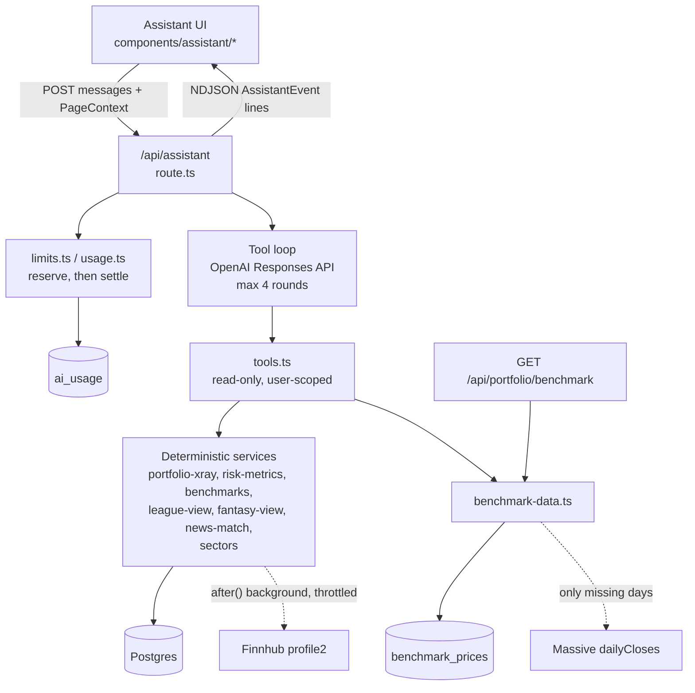

# Architecture

## Data flow

Wealth Lab (`/wealth`, `lib/wealth/engine.ts`) and Replay (`lib/replay.ts`) are client-side calculators; **no assistant tool calls them**. They are shown separately from the diagram's services on purpose.

## Request lifecycle (`app/api/assistant/route.ts`)

1. `getCurrentUserId()`; 401 if absent. 503 if no `OPENAI_API_KEY`.
2. `cleanHistory` / `cleanContext` sanitize input (max 12 messages, 2000 chars each).
3. Input bound check (`maxInputTokens` 24,000, measured by UTF-8 bytes as an upper bound); 413 if over.
4. `reserve()`: one transaction under a per-user advisory lock checks hourly count, per-user daily USD and monthly total, then inserts a worst-case reservation. 429 with a reason otherwise.
5. Stream loop up to `maxToolRounds` (4): call the model, forward text deltas, run any function calls via `runTool`, append outputs, repeat.
6. `finally`: `settle()` replaces the reservation with actual token cost, only if usage was reported; otherwise the worst case stays as the cost.

Tool errors reach the model as a generic `{ error }`; details go to the server log only.

## Tools (`lib/ai/tools.ts`)

`get_portfolio_xray`, `get_holdings`, `get_my_leagues`, `get_league_standings`, `get_fantasy_league`, `compare_to_benchmark`, `get_market_news`. The model never supplies a user id; `ToolContext.userId` is bound server-side. Page league ids are hints, checked via membership before use.

## Shared contracts

| Contract | Defined in | Shape / purpose |
|---|---|---|
| `AssistantEvent` | `app/api/assistant/route.ts` | `status` (reading/analyzing/writing), `text` delta, `xray` (full report), `error`, `done`. One JSON object per line. Consumed by `components/assistant/use-assistant.tsx`. |
| `ToolContext` | `lib/ai/tools.ts` | `userId`, optional `pageLeagueId`, `pageFantasyId`, `emit` (lets a tool push an `xray` event to the UI). |
| `XRay` | `lib/ai/portfolio-xray.ts` | `asOf`, `overview`, `allocation`, `sectors` (slices, coverage, partial flag), `concentration`, `performance` (today, all-time, TWR period), plus risk flags. Flag thresholds are heuristics (`LIMITS`, `SECTOR_WATCH` etc.). |
| `BenchmarkResponse` | client type in `components/dashboard/benchmark-compare.tsx`; server shape in `app/api/portfolio/benchmark/route.ts` | `symbol, label, basis: "price", comparison \| null, reason`. Comparison holds start/end dates, both percentages, point difference, `coverage`, indexed series. Always HTTP 200; reasons: `no-history`, `no-benchmark-data`, `starts-late`. |
| `PageContext` | `lib/ai/limits.ts` | `{ page: portfolio\|leagues\|fantasy\|news\|board\|other, entityId? }`; drives page-specific prompt guidance. |

## Spend ledger

`ai_usage` (migration 0022): `user_id` (cascade delete), `model`, `reserved_usd`, `cost_usd` (null until settled), token counts, `created_at`. Unsettled rows count at `reserved_usd`. Defaults in [README](README.md#turning-it-on).

## Benchmark data

`benchmarkCloses` serves from `benchmark_prices`; it asks Massive only for missing history (backfill once, then days since the last stored close), at most once per symbol per 6 h per server process (in-memory map, so per instance). Provider failure falls back to stored rows.

## Sectors

`loadXRay` calls `scheduleSectorRefresh` for equities without a sector; it runs after the response (`after()`), throttled to once per 60 s per process, and calls Finnhub `/stock/profile2` through `withProviderCaller`. Results are stored on `securities` (`sector`, `industry`, `sector_checked_at`); retry cadence is governed by `SECTOR_RETRY_DAYS` / `SECTORS_PER_RUN` in `lib/positions.ts`.
